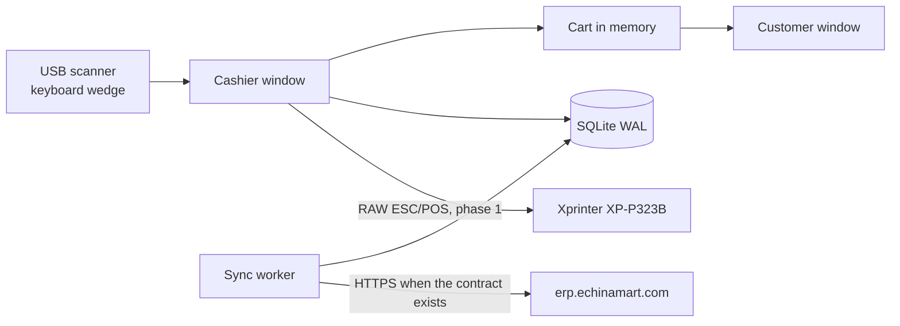

# EgyChina POS — Windows cashier architecture

Local-first cashier for **ايجي شاينا ماركت / EgyChina**, branch **سوق العبور** (Souq El Obour hypermarket). The online system of record stays [egychina-erp](https://erp.echinamart.com) (Next.js, Prisma, SQLite). This desktop app is a new terminal class. It does not replace the Expo app `egychina-pos-app`, and it does not call WordPress or WooCommerce.

The runnable shell in this repo opens the cashier window and the customer window, creates the SQLite database, and runs a sync worker that does not post sales yet. Selling, printing, and the ERP contract below are the build spec for the next phases.

## 1. Verified on the live ERP (5 Nov 2026)

Checked without credentials:

| Observation | Result |
| --- | --- |
| Login page | Arabic staff login, title **ايجي شاينا ماركت** |
| `GET /pos` | Redirects to `/login?callbackUrl=/pos` (the browser POS is a logged-in page) |
| `GET /api/auth/providers` | Auth.js / NextAuth **credentials** provider |
| `GET /api/auth/session` | `null` when no cookie is present |
| `GET /api/health`, `/api/pos`, `/api/products`, `/api/sales`, `/api/shifts` | Each returned `401 {"error":"Unauthorized"}` |

That 401 is the same body on every probed `/api/*` path except `/api/auth/*`. It is an auth gate. It does **not** prove those routes exist. The disabled WooCommerce sync (HTTP 410) was not visible from outside the gate.

No device-token or outbox API was visible. Every endpoint in [erp-sync-contract.md](erp-sync-contract.md) is a proposal. Each one is marked **ASSUMPTION**.

## 2. UI stack

**Choice: Avalonia 12 on .NET 8, one WinExe, software rendering on Windows.**

WinUI 3 was the other candidate. It is the wrong fit for this fleet:

| | Avalonia 12 | WinUI 3 |
| --- | --- | --- |
| Extra runtime | .NET 8 only | .NET plus the Windows App SDK bootstrapper |
| Deploy | `dotnet publish -r win-x64` folder, xcopy | MSIX or a matching Windows App Runtime install |
| Dual monitor | `Window.Position` + `Screens` in this process | AppWindow placement has been brittle across SDK versions |
| Old GPU | Can force Skia software rendering | Composition is DirectX; Intel HD 520 drivers are a known support cost |
| ESC/POS | Not the UI toolkit’s job. Raw spooler either way | Same |
| Arabic | HarfBuzz. Segoe UI on Windows, Noto Naskh Arabic otherwise | DirectWrite. Also fine |
| Memory | One toolkit in-process | WinAppSDK stays resident before the first barcode |

Printing and serial I/O do not get better with WinUI. The cashier PCs are the constraint: **Intel i5-6300U, Intel HD Graphics 520, 8 GB RAM, SSD**. A static form does not need a compositor.

On Windows the shell sets:

- `Win32RenderingMode.Software` — CPU raster into a framebuffer. HD 520 is not asked to present the UI.
- `Win32CompositionMode.RedirectionSurface` — avoids Avalonia 12’s default WinUI composition path, which has produced `RequestCommitAsync timed out` failures, and which requires the ANGLE/Direct3D backend anyway.
- Per-monitor DPI — primary and customer screens often differ.

Linux and a dev VM ignore those Win32 options. The same binary layout runs there for development.

The assemblies target `net8.0`. Building Avalonia 12 needs the Roslyn compiler that ships with the .NET 10 SDK (`global.json`). A self-contained publish still embeds the .NET 8 runtime, so a till does not install a second runtime.

Electron and a wrapped copy of `/pos` were rejected. A browser plus a web POS is the memory budget we are leaving, and it is not offline in the way a checkout lane needs.

## 3. Context



- Cashiers stop using the browser at `/pos`. The page can stay for back office until parity.
- `egychina-pos-app` (Expo) stays the phone/tablet terminal. Do not port that UI into this repo.
- WooCommerce is not a dependency. Legacy Woo sync on the ERP is disabled and this app must not recreate it.
- One store code in the skeleton: `OBOUR`. **ASSUMPTION:** Souq El Obour is a single store until enrollment says otherwise.

## 4. Process and windows

One process. Two windows. No second process and no IPC.

The cart is one object owned by the UI thread. The customer window binds to it, so the total on the facing screen cannot lag a pipe. SQLite is in-process. A second POS process on the same file is refused with a named mutex (`EgyChina.Pos.SingleInstance`).

| Window | Screen | Chrome | Content |
| --- | --- | --- | --- |
| Cashier | Primary, maximized | Normal | RTL Arabic. Scan, search, cart, sync state, clock |
| Customer | Secondary, borderless, topmost, fullscreen | None | RTL Arabic, Chinese name under the line when we have one. Totals only |

Placement (`ScreenLayout`):

1. Read `Window.Screens` after the window is opened. Retry a few times if the platform has not published screens yet.
2. Primary = `Screens.Primary`. Secondary = any other screen whose bounds differ.
3. Move the cashier to the primary screen’s pixel origin, then maximize. Position is in physical pixels; do not assign `Width` from pixel bounds or DPI will double the size.
4. If a second screen exists, put the customer window on that origin and then fullscreen it.
5. If the PC has one screen (dev machines, a disconnected cable), dock the two windows side by side and say so on the cashier. Never cover the scanner field with the customer window.

Customer window rules:

- It is not the main window. Closing it does not exit. **شاشة العميل** opens it again.
- `ShowActivated = false` so a scan does not land in the facing screen.
- It must not show cost, margin, PIN, sync errors, or the outbox.
- Closing the cashier window closes the process and the customer window with it.

**ASSUMPTION:** the barcode scanner is a USB HID keyboard wedge that types the code and sends Enter. The shell keeps focus in the barcode box and selects the text after each Enter, so the next scan replaces the previous code. A global “steal digits while search is focused” hook is phase 1, not this shell.

Copy is Arabic. Digits and money stay Western (`85.00 ج.م`) under the invariant culture, which matches a keyboard and a scanner. Do not switch the process culture to `ar-EG`.

## 5. Projects

| Project | Now | Later |
| --- | --- | --- |
| `EgyChina.Pos.App` | Windows, session, screen placement | PIN screen, tender, shift UI |
| `EgyChina.Pos.Core` | Money math, catalog row, sync status, `IReceiptPrinter` | Sale and tender types |
| `EgyChina.Pos.Data` | SQLite open, migration, demo seed, log, paths | Repositories used by the sale transaction |
| `EgyChina.Pos.Sync` | Outbox post to the live `/api/checkout` route, gated until cookie, money scale, and payment method are set | Server-side idempotency once the ERP repo is available |
| `EgyChina.Pos.Tests` | WAL, seed, outbox idempotency, rounding, worker | Sale transaction tests |
| `EgyChina.Pos.Printing` | Not created | Raw Winspool ESC/POS in phase 1 |

Composition is manual in `App.axaml.cs`. A generic host is extra startup on a 2-core CPU for no current gain. Add it only if the worker count grows past one loop.

There is no Entity Framework. The lane needs short transactions and a file we can read with the `sqlite3` CLI when a till misbehaves.

## 6. Startup and the cashier PC

Target OS: **64-bit Windows 10 version 1809 or later, or Windows 11**. .NET 8 does not support Windows 7. Confirm `winver` on a real till before any rollout. **ASSUMPTION:** these i5-6300U PCs are already on 64-bit Windows 10.

Boot path, phase 1 (not implemented in the shell):

1. Local standard user `pos`, not an administrator.
2. Auto-logon for that user (the password lives in LSA via a tool such as Sysinternals Autologon, not in this repo).
3. A Startup-folder shortcut to `EgyChina.Pos.exe`. Shell Launcher / Assigned Access is better and is Windows Enterprise or IoT only. **ASSUMPTION:** the tills are Windows 10/11 Pro, so Startup + auto-logon is the path that actually works.
4. Power: never sleep, disks never off, USB selective suspend off, BIOS “after power loss = last state”.
5. Outbound firewall: TCP 443 to `erp.echinamart.com` only, plus the update host if it is different.
6. Windows Update runs when the store is closed. Do not disable it, and do not let it reboot an open shift.
7. Real-time antivirus should exclude `%LOCALAPPDATA%\EgyChina\Pos\`. Scanning the WAL on every commit shows up as slow receipts.

The shell itself only enforces the single instance and writes a log. Kiosk policy is an install step, documented in the README.

Data directory:

- Windows: `%LOCALAPPDATA%\EgyChina\Pos\`
- Linux dev: `~/.local/share/EgyChina/Pos/`

Files: `pos.db`, `pos.db-wal`, `pos.db-shm`, `logs\pos.log`.

## 7. Local database

Executable schema: [`src/EgyChina.Pos.Data/Migrations/001_init.sql`](../src/EgyChina.Pos.Data/Migrations/001_init.sql).

Every connection sets `foreign_keys=ON`, `busy_timeout=5000`, `synchronous=NORMAL`. The file is switched to `journal_mode=WAL` once at initialize. WAL is the right mode for one writer (the UI) and one reader (the worker) in the same process. The process also takes a single lock around database methods so the two callers cannot interleave commands. That lock is enough while there is one process. Do not open this file from a helper exe.

Money is a signed integer in minor units (EGP piasters, CNY fen). Quantities are milli-units (`1000` = 1). No IEEE floats in prices, totals, or rates. Rates are a rational `numerator/denominator`.

| Table | Role |
| --- | --- |
| `schema_migration` | Applied migration id |
| `terminal` | Stable local id, store code, display name. Created once |
| `app_setting` | Small keys (`catalog.source`, later `printer.queue`) |
| `product` | Catalog replica. Arabic name required. English and Chinese optional. Barcode unique when present |
| `product_price` | Shelf price per currency. MVP charges the EGP row |
| `exchange_rate` | Pulled customer rate, already including margin, plus `margin_bps` for the journal |
| `cashier` | Id, role (`cashier`, `supervisor`, `manager`), PBKDF2 hash and salt |
| `shift` | Open/close and float. Synced as its own outbox aggregate |
| `sale` | Local GUID primary key, optional server id, receipt number, totals, FX snapshot, sync status |
| `sale_line` | Snapshotted name and price. A later catalog edit must not rewrite a receipt |
| `payment` | One row per tender. `amount_minor` in the tender currency, `amount_egp_minor` after the snapshot rate |
| `outbox` | Pending events. Unique `idempotency_key` |
| `sync_cursor` | Per-stream cursor (`catalog`, `cashiers`, `rates`, `qr`, `worker`) |
| `qr_asset` | Instapay and WeChat QR image bytes |
| `receipt_counter` | Single row, `next_no`. Gaps are allowed. Reuse is not |

The in-progress cart is **not** a table. A crash loses the basket and cannot lose a committed sale. Completed sales are written before any print.

Demo seed: if `product` is empty and `catalog.source` is not `erp`, three `DEMO-*` rows are inserted and `catalog.source` is set to `demo`. A future pull sets `catalog.source=erp` and deletes `DEMO-*`. The seed must not come back over a real empty catalog.

### Sale transaction

Cash EGP uses this order in `PosDatabase.CompleteCashSale`. Print is still not wired; the cart is cleared only after commit.

One SQLite transaction, in this order:

1. Allocate `receipt_no` from `receipt_counter` (increment in the same transaction).
2. Insert `sale`, `sale_line`, `payment`.
3. Insert the `outbox` row with key `{terminalId}:sale:{saleId}` and status `pending`.
4. Commit.
5. Clear the in-memory cart. Both windows then show the change and the receipt number.
6. Print. Not built yet. When it is added it stays after commit, never before.

If the process dies before commit, there is no sale. If it dies after commit, the sale and the outbox row are already stored. Never print first.

Push retries use the same idempotency key. The server returns the original `serverId`. The client stores it on `sale.server_id` and marks the outbox row `done`. A completed sale is never moved to `dead` because the network failed. `dead` is only for a payload this build cannot send (poison). The cashier status bar shows an outbox that is not draining.

Catalog pull and cursor advance commit in one transaction, so a crash cannot skip a page or apply it twice.

**ASSUMPTION:** shelf prices are tax-inclusive. `tax_rate_bps` is stored and not added on top. Confirm with finance before phase 1 charges anyone. Egyptian VAT is not a flat 14% on this grocery mix.

**ASSUMPTION:** offline stock is not a hard block. The ERP remains the stock authority. Two tills can sell the last unit offline. Oversell is reconciled on the server. Blocking the belt on a stale local quantity is worse.

## 8. Money and FX

`Money.ApplyRate` is the only conversion:

```text
round_half_up(|amount| * numerator / denominator) with the sign restored
```

Implemented with integer arithmetic in a `checked` block. ERP and POS must use this definition. If the server keeps decimal rates, it converts them to a rational before they reach a till, it does not send a `double`.

**ASSUMPTION:** the ERP sends the customer rate (market rate already marked up by `margin_bps`). The till does not apply margin a second time. It stores `margin_bps` on the sale so finance can see it, and it stores the rational it actually used.

Worked example, locked by a unit test: 100 fen at 7107/1000 → 711 piasters (`7.11 ج.م`).

Currencies in scope: `EGP`, `CNY`. Tender methods in the schema: `cash_egp`, `cash_cny`, `wechat`, `instapay`, `card`. MVP enables `cash_egp` only.

**ASSUMPTION:** card means an external terminal. This app stores the amount and an approval code. It does not read PAN, track, or PIN data.

**ASSUMPTION:** WeChat and Instapay are static QR images on the customer screen, and the cashier types the amount received. A dynamic amount-QR is a different endpoint and is not required to open the lane.

## 9. Sync

The worker is a `PeriodicTimer` (30 seconds) on a background task. It never blocks the UI thread.

With no `EGYCHINA_POS_API`, each tick stays local and writes cursor `not-configured`. It does not open a socket.

When the origin, the Auth.js session cookie, a money scale, and a payment-method string are all set, the tick posts pending sales to the live `POST /api/checkout` route. A sale is marked synced only after a full HTTP 2xx. Details, and what is still not visible in the ERP source, are in [erp-sync-contract.md](erp-sync-contract.md).

Full request and response shapes, cursors, and the list of new routes: [erp-sync-contract.md](erp-sync-contract.md).

Device credentials, when they exist, do not go in SQLite. They go through Windows DPAPI (`ProtectedData`) or Credential Manager, in phase 1. The shell has no token store yet because it has no token.

## 10. Printing

Printer in use elsewhere: **Xprinter XP-P323B**, ESC/POS, typically 80 mm at 203 dpi (576 dots). Confirm the actual Windows queue on a till. **ASSUMPTION:** it is installed as a USB printer queue, not as a COM port. Some Xprinter USB modes also expose a virtual COM port; support that as a second transport, not the primary.

Do not print receipts through GDI or XPS. Drivers reflow text, and Arabic plus Chinese on one ticket will not survive a code page (`PC864`, `WPC1256`).

Phase 1 printer:

1. Render the receipt to a 576-dot-wide monochrome bitmap with Skia (already in Avalonia) and the same Arabic font as the UI.
2. Send ESC/POS initialize, the raster (`GS v 0`), feed, and cut.
3. Write the bytes with Winspool: `OpenPrinter`, `StartDocPrinter` datatype `RAW`, `WritePrinter`, `EndDocPrinter`.
4. If the site uses the virtual COM port instead, write the same bytes to that port with `System.IO.Ports`.
5. Config keys: `printer.transport` = `raw-spooler` or `serial`, `printer.queue` or `printer.port`.

`IReceiptPrinter` / `ReceiptDocument` in `EgyChina.Pos.Core` are the seam. Cash sales commit without printing. A receipt on paper is still to be built, so a committed sale can be looked up in SQLite and is not yet reprinted.

**ASSUMPTION:** a cash drawer, if present, is kicked from the printer RJ11 port with `ESC p` after a cash tender. Not required for the first sale.

A failed print after a committed sale leaves the sale in SQLite. The cashier reprints. The outbox row is independent of the printer.

## 11. Security

Threat model: a till in a busy hypermarket. People can touch the keyboard. A disk image of the PC is possible and is the serious case. This is not a multi-tenant server.

| Item | Decision |
| --- | --- |
| Staff login | Local PIN check against `cashier.pin_hash`. Phase 1 |
| PIN storage | PBKDF2-HMAC-SHA256, 210_000 iterations, 16-byte salt, synced as hash + salt |
| PIN length | 6 digits minimum. A 4-digit PIN is brute-forceable offline even with PBKDF2 |
| Lockout | 5 failures, then 5 minutes, stored locally. Supervisor clears it |
| Device auth | Separate from the human PIN. Bearer token issued at enrollment. Not the NextAuth browser cookie |
| Token at rest | DPAPI or Credential Manager. Not a column in `pos.db` |
| Database file | NTFS ACL for the `pos` user only. SQLCipher is not in the MVP; add it only if disk-image theft becomes a real requirement |
| Browser session | Do not reuse the staff cookie. It expires, it is a person, and it is the wrong lifetime for a till |
| Card data | Not stored. Not even temporarily |
| Customer screen | Sell price, quantity, total, and (phase 2) the payment QR. Nothing else |
| Transport | HTTPS to the ERP host. OS trust store. Pinning can wait |
| Logs | Local rolling file, 14 days target (the shell rotates one backup at 2 MB). No third-party telemetry |
| Updates | Authenticode-signed binaries. No unsigned zip from a share |

The NextAuth credentials provider on the ERP is for people in a browser. Terminals need their own credential so a cashier leaving does not un-enroll the PC, and so a stolen PIN cannot mint a new till.

SQLite is not encrypted in this phase. Say that plainly to whoever signs off: anyone who copies `pos.db` gets the catalog, the local sales journal, and PIN hashes. Hashes are not the PIN, but a short PIN can be attacked offline. DPAPI on the file’s key is the upgrade path; it is useless if the attacker also has the Windows user profile, which is why the `pos` user must not be an admin and the disk should be the store’s, not a laptop that goes home.

## 12. Updates and deploy

Phase 1 install is a versioned directory, not a framework-dependent “it works on my SDK” layout:

```text
C:\EgyChina\Pos\app\<version>\
C:\EgyChina\Pos\current\     junction to the version the launcher starts
```

Publish **on Windows** (or a Windows CI agent):

```powershell
dotnet publish src\EgyChina.Pos.App\EgyChina.Pos.App.csproj -c Release -r win-x64 --self-contained true -p:PublishReadyToRun=true
```

Self-contained, not single-file. Avalonia’s native assets and single-file publish fight each other. ReadyToRun trades disk (~a few extra tens of MB) for a faster cold start on a 2.4 GHz Skylake core. Workstation GC, not server GC (set on the app project).

Do not trim. Avalonia and the MVVM source generator are a bad trim target, and a broken trim on a till is a closed lane.

The launcher (phase 1, small second exe or a careful script) starts `current`. It applies an update only when no shift is open, keeps the previous directory, and rolls back if the new exe does not reach a heartbeat. Sign the exe. **ASSUMPTION:** the feed is `GET /api/pos/v1/releases/latest`, described in the contract. Until that exists, copy the folder by hand.

Velopack can replace the hand-rolled launcher in phase 2. It is the boring .NET choice. ClickOnce and MSIX are not.

Expected self-contained size is on the order of 150–250 MB because of the runtime, ICU, and Skia. Disk is an SSD. RAM is the limit that matters.

## 13. Performance budget (i5-6300U, 8 GB, SSD)

| What | Budget |
| --- | --- |
| Cold start to a focused barcode box, ReadyToRun, catalog already local | 4 seconds typical, 8 seconds acceptable |
| Working set after a 20k SKU catalog | Under 350 MB |
| Barcode lookup | Indexed equality, under 20 ms, off any animation |
| UI thread | No network, no print raster, no migration |
| Sync | Background task, batch under a few hundred rows, backoff from 15 s to 15 min |
| Render | Software. No storyboards, no blur, no product photos on the hot path |
| GC | Workstation, concurrent. Already the default we keep |
| Catalog cache | The full active catalog in memory plus the SQLite barcode index. 50k names is about 10 MB and is fine. Revisit only past ~100k |

Windows itself on 8 GB leaves limited headroom once an antivirus and the spooler are up. The till user should not have Chrome, the ERP admin UI, or the old browser POS open beside this app.

First catalog pull can take a while. The cashier UI stays usable on the previous replica. The first install has the demo seed, and cash EGP works on that seed so a lane can be tried with the network unplugged. Refusing **إتمام الدفع** until `catalog.source=erp` comes back with enrollment. Until then sales are stamped `local-cashier`, which is not a synced PIN.

## 14. Failure behavior

| Failure | Lane |
| --- | --- |
| ERP down | Sell from the local catalog. Outbox grows. Status bar says the server was not reached. Do not block cash |
| Outbox stuck | Keep selling. Status stays visible. Never drop a committed sale |
| Customer screen unplugged | Single-screen layout. Cashier keeps scanning |
| Printer offline | Sale stays committed. Reprint when the queue is back. Do not void automatically |
| Disk full | Stop new sales. Still allow reprint of the last receipt. Needs a free-space check in phase 1 |
| Bad barcode | Hint on the cashier, nothing on the customer screen |
| Second launch | Exit immediately. One mutex |
| DB corrupt | Stop at startup with the Arabic error window and the log path. Do not recreate over a corrupt file silently |
| Clock wrong | `receipt_no` is the till order. Timestamps are informational. Enrollment should record skew; not in the shell |

## 15. What the shell actually does

Implemented:

- Cashier window, Arabic RTL, and a customer window on the second screen when one exists.
- SQLite file, WAL, the migration, demo catalog, terminal row, placeholder local cashier.
- Scan box, search, shared cart, totals on both windows.
- Cash EGP checkout: tender, change, committed sale, and a pending outbox row. The cart clears after commit.
- Sync worker. It posts to `/api/checkout` only when the verified gates are set, and it marks a sale synced only after a full 2xx. Default configuration does not open a socket.
- Log file, single instance, startup error window.

Not implemented, on purpose:

- PIN, shifts, void, refund, discount, print, reprint.
- Any POST of a sale. The outbox waits for the device API in the contract, which is still an **ASSUMPTION**.
- ESC/POS bytes, QR images, CNY tender, catalog pull.
- Auto-logon, the launcher, code signing.
